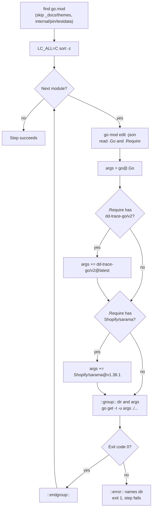

# Proposal: update `dd-trace-go/v2` only in modules that require it

> Temporary file. Delete it before merge.

## Goal

Make `.github/workflows/deps-update.yml` succeed again on `main`, so that the
weekly `chore: update all dependencies` PR is created again. The workflow must
not add `dd-trace-go/v2` to modules that do not use it.

## Problem

- The "Update dependencies" step runs this command for each `go.mod`
  (`deps-update.yml:45`):
  `go get -t -u go@<module go> github.com/DataDog/dd-trace-go/v2@<latest> ./...`
- `go get` adds each module named on its command line to `go.mod`. Thus the
  step adds `dd-trace-go/v2` to modules that do not use it.
- `dd-trace-go/v2@v2.12.0` requires `go 1.26.0`. `_tools/go.mod` has
  `go 1.25.0`. The `go@1.25.0` argument blocks the upgrade, so `go get` fails
  (run `45119665920`, 2026-11-23):
  `github.com/DataDog/dd-trace-go/v2@v2.12.0 requires go@1.26.0, not go@1.25.0`
- The loop stops at the first error. The module order is not fixed (no
  `sort`). The log does not show which module each command runs in.

## Options

| | A: gate on `.Require` | B: `_tools` to `go 1.26.0` | C: A and B |
|---|---|---|---|
| Fixes the 2026-11-23 error | Yes | Yes | Yes |
| Files changed | `deps-update.yml` | `_tools/go.mod` | Both |
| Adds `dd-trace-go/v2` to modules that do not use it | No | Yes (then `go mod tidy` removes it) | No |
| Side effects in `_tools` | None | 8 indirect modules raised by dd-trace-go requirements | `go` line only |
| Stops the same failure for a new module with an older `go` line | Yes | No | Yes |

### Option A: gate `dd-trace-go/v2@<latest>` on `.Require` (recommended)

- Read `go mod edit -json` one time for each module. Add
  `dd-trace-go/v2@<latest>` to the arguments only if `.Require` contains
  `github.com/DataDog/dd-trace-go/v2` (direct or `// indirect`). This is the
  same check as the `Shopify/sarama` check at `deps-update.yml:42`.
- Selected modules on `main`: `.`, `instrument` (indirect), `_docs`,
  `samples`. Not selected: `_tools`, `test/e2e/testdata/pgo`,
  `test/e2e/testdata/compileloop`.
- Pipe both `find` loops into `LC_ALL=C sort -z`. The order is then the same
  on each run and on each runner locale.
- Write one `::group::` per module, with the module directory and the
  arguments. On failure, write `::error::` with the module directory.
- Tradeoff: `_tools` stays on `go 1.25.0`. `go get -u go@1.25.0` does not
  select tool updates that need Go 1.26. Today, no update is held back: with
  `go@1.26.0`, `go get -t -u ./...` in `_tools` changes only the `go` line.

### Option B: bump `_tools/go.mod` to `go 1.26.0`

- One-line change. It removes the conflict in `_tools` today.
- The workflow still names `dd-trace-go/v2` in `_tools`, `pgo`, and
  `compileloop`. `go get` adds it. Minimal version selection then raises the
  shared indirect modules to the versions that dd-trace-go requires.
  `go mod tidy` removes `dd-trace-go/v2`, but it does not lower the raised
  versions. Local result in `_tools`: `x/mod v0.37.0 → v0.41.0`,
  `x/tools v0.47.0 → v0.51.0`, and 6 more. `x/tools` and `x/mod` are build
  dependencies of `go-licenses`.
- The same failure comes back for each new module with an older `go` line.
- Rejected: it removes the symptom, not the cause.

### Option C: A and B

- Same result as A, plus a `go` line change in `_tools` that no dependency
  needs today.
- Rejected for this change. A separate PR can bump `_tools` if the owners want
  it.

**Recommendation: Option A.** It removes the cause: the workflow names a
module that `_tools` does not use. It changes one file. A local run of the full
loop on `main` passed (see [Evidence](#evidence)).

## Constraints

1. **`validate.yml` (`GOTOOLCHAIN: local`, `go-version: [oldstable, stable]`)**
   - `validate.yml:19` sets `GOTOOLCHAIN: local`. CI never downloads a
     toolchain. The `go` line of each module must be less than or equal to
     the Go release of the runner.
   - These jobs build `_tools` with `oldstable`: the unit-test matrix
     (`validate.yml:263`, `validate.yml:280`), the `generate` job
     (`validate.yml:33`, then `make-licenses.sh` at `validate.yml:72`), and
     `pr-labeler.yml:19-22`.
   - Measured on 2026-11-23: `oldstable` is `go1.26.11` (validate run
     `45106105554`, job `137468377044`). `stable` is `go1.27.4`.
   - Option A keeps `_tools` at `go 1.25.0`, so it builds on both. Option B
     also builds (1.26.0 ≤ 1.26.11). The root `go.mod` is already
     `go 1.26.0`, so B adds no new minimum.
2. **`_tools/make-licenses.sh` and `LICENSE-3rdparty.csv`**
   - The script builds `go-licenses` from `_tools` (`make-licenses.sh:9`). It
     reports the root module only (`./...` from the repository root).
   - Option A does not change `_tools/go.mod` or `_tools/go.sum`. The
     `go-licenses` binary stays the same. The CSV changes only when root
     dependencies change.
   - The bot PR must contain the regenerated CSV. If not, the `generate` job
     in `validate.yml` fails on a dirty tree. The current step at
     `deps-update.yml:59-63` does this. Do not change it.
3. **Module isolation**
   - The workflow must not add a `require` line for `dd-trace-go/v2` to a
     module that does not have one.
   - After the loop, `_tools/go.mod`, `test/e2e/testdata/pgo/go.mod`, and
     `test/e2e/testdata/compileloop/go.mod` have no `dd-trace-go/v2` line.
4. **Rollout and recovery with `workflow_dispatch`**
   - Before merge, verify with a local dry run only. Do not dispatch the
     workflow on the PR branch: `create-pr` pushes
     `automation/dependency-updates/<run_id>` (`deps-update.yml:98-99`), and
     then fails at the token step. The token policy accepts only
     `refs/heads/main`
     (`.github/chainguard/self.github.deps-update.schedule.sts.yaml:3-9`).
   - After merge, run
     `gh workflow run deps-update.yml -R DataDog/orchestrion --ref main`. The
     policy accepts `event_name: (schedule|workflow_dispatch)` on `main`.
   - If the run fails, the `::error::` annotation names the module. Fix
     forward in a new PR, then dispatch again. A revert does not help: the old
     loop fails on `_tools`.
   - The next scheduled run (Monday 2026-11-30, 05:42 UTC) confirms the
     `schedule` path.

## Updated per-module loop



The "Run go mod tidy" loop uses the same `find` and `sort`, one `::group::`
per module, and `::error::` on failure. Its commands do not change.

## Change outline

1. `.github/workflows/deps-update.yml:35-46` ("Update dependencies"):
   - Add `env: DD_TRACE_GO_VERSION: ${{ steps.dd-trace-go.outputs.version }}`.
     It replaces the `${{ }}` expression inside the script.
   - Add `set -euo pipefail`.
   - Pipe `find ... -print0` into `LC_ALL=C sort -z`.
   - Read `go mod edit -json` one time into `modjson`.
   - Build `args`: `go@<.Go>`, then `dd-trace-go/v2@${DD_TRACE_GO_VERSION}`
     if `.Require` has it, then `Shopify/sarama@v1.38.1` if `.Require` has
     it. Keep the comment at `deps-update.yml:40-41`.
   - Put each `go get` in `::group::` and `::endgroup::`. On failure, write
     `::error::` with the directory, then `exit 1`.
2. `.github/workflows/deps-update.yml:47-53` ("Run go mod tidy"): add
   `set -euo pipefail`, `LC_ALL=C sort -z`, `::group::`, and `::error::`. Keep
   the `go mod tidy` and `-toolchain=none` commands.
3. Do not change `_tools/go.mod`.

Body of the loop in step 1:

```bash
modjson="$(go -C="${dir}" mod edit -json)"
args=("go@$(jq -r .Go <<<"${modjson}")")
if jq -e 'any(.Require[]?; .Path == "github.com/DataDog/dd-trace-go/v2")' >/dev/null <<<"${modjson}"; then
  args+=("github.com/DataDog/dd-trace-go/v2@${DD_TRACE_GO_VERSION}")
fi
if jq -e 'any(.Require[]?; .Path == "github.com/Shopify/sarama")' >/dev/null <<<"${modjson}"; then
  args+=(github.com/Shopify/sarama@v1.38.1)
fi
echo "::group::go get in ${dir}: ${args[*]}"
if ! go -C="${dir}" get -t -u "${args[@]}" ./...; then
  echo "::endgroup::"
  echo "::error title=go get failed::${dir}: go get -t -u ${args[*]} ./..."
  exit 1
fi
echo "::endgroup::"
```

## Verification commands

Local dry run (about 10 to 15 minutes). It uses a scratch copy, so the
checkout stays clean:

```bash
# 1. Make a scratch copy. (In the agent sandbox, `git archive` fails because of git-lfs. rsync works.)
rsync -a --exclude .git ./ ../dry-run/
# 2. Copy the two new `run:` bodies ("Update dependencies", then "Run go mod tidy") into ../dry-run.sh
# 3. Run them as CI does
cd ../dry-run
export GOTOOLCHAIN=local
export DD_TRACE_GO_VERSION="$(go list -f '{{range .Versions}}{{.}}{{"\n"}}{{end}}' -m -versions github.com/DataDog/dd-trace-go/v2 | grep -v '-' | tail -n 1)"
bash ../dry-run.sh 2>&1 | tee ../dry-run.log
# 4. Check the module list and the arguments (expect 7 lines)
grep '::group::go get' ../dry-run.log
# 5. Check module isolation (expect 0 for each file)
grep -c 'dd-trace-go/v2 ' _tools/go.mod test/e2e/testdata/pgo/go.mod test/e2e/testdata/compileloop/go.mod
# 6. Check the license step and the _tools build (expect exit code 0)
mkdir -p ../dry-run-tmp && TMPDIR="${PWD}/../dry-run-tmp" ./_tools/make-licenses.sh
go -C _tools build -o "${PWD}/../dry-run-tmp/bin/" gotest.tools/gotestsum
```

Lint (about 1 minute, in the real checkout):

```bash
actionlint .github/workflows/deps-update.yml
yamlfmt -lint .github/workflows/deps-update.yml
```

After merge:

```bash
gh workflow run deps-update.yml -R DataDog/orchestrion --ref main
gh run list -R DataDog/orchestrion --workflow deps-update.yml --event workflow_dispatch --limit 1
```

## Evidence

Local run on 2026-11-23, `main` at `c249c32`, `go1.27.4`, `GOTOOLCHAIN=local`:

- The full loop with the Option A logic exited 0 in 8 minutes. Order:
  `./_docs`, `./_tools`, `.`, `./instrument`, `./samples`,
  `./test/e2e/testdata/compileloop`, `./test/e2e/testdata/pgo`.
- `dd-trace-go/v2@v2.12.0` was in the arguments for `./_docs`, `.`,
  `./instrument`, and `./samples` only. `Shopify/sarama@v1.38.1` was in the
  arguments for `./_docs`, `./instrument`, and `./samples`.
- `_tools`, `pgo`, `compileloop`: `go.mod` and `go.sum` did not change.
  Root, `instrument`, `_docs`, and `samples` were updated.
- `make-licenses.sh` exited 0 (2 changed CSV lines).
  `go -C _tools build gotest.tools/gotestsum` exited 0. `go build ./...` in
  the root module exited 0.
- A full step with this logic passed `actionlint` and `yamlfmt -lint` (with
  the repository `.yamlfmt`).

## Acceptance criteria

- [ ] `[local-dry-run]` The new loops exit 0 on a scratch copy of `main` with
      Go `stable` (1.27.x) and `GOTOOLCHAIN=local`.
- [ ] `[local-dry-run]` The log has 7 `::group::go get` lines in C-locale
      order. `dd-trace-go/v2@<latest>` is in the arguments for `./_docs`,
      `.`, `./instrument`, and `./samples` only.
- [ ] `[local-dry-run]` After the loops, `_tools/go.mod`,
      `test/e2e/testdata/pgo/go.mod`, and
      `test/e2e/testdata/compileloop/go.mod` have no `dd-trace-go/v2` line.
- [ ] `[local-dry-run]` After the loops, `./_tools/make-licenses.sh` and
      `go -C _tools build gotest.tools/gotestsum` exit 0.
- [ ] `[ci-validate]` All `validate.yml` checks on the PR pass, including
      "Run actionlint". `yamlfmt -lint` passes locally.
- [ ] `[ci-validate]` The final PR diff changes only
      `.github/workflows/deps-update.yml`. `_tools/go.mod` still has
      `go 1.25.0`.
- [ ] `[workflow-dispatch]` After merge, a `workflow_dispatch` run on `main`
      ends with `success` for the `update-go` and `create-pr` jobs.
- [ ] `[workflow-dispatch]` The "Update dependencies" log of that run has one
      group for each module.
- [ ] `[pr-output]` The run opens a `chore: update all dependencies` PR from
      `automation/dependency-updates/<run_id>`.
- [ ] `[pr-output]` That PR adds no `dd-trace-go/v2` line to a `go.mod` that
      did not have one. It contains `LICENSE-3rdparty.csv` when root
      dependencies change.

## Review requirements

Before merge:

1. Standard code review of `deps-update.yml`. Check that:
   - `set -euo pipefail` is present, and a failure in the `while` subshell
     fails the step.
   - Arrays are quoted (`"${args[@]}"`).
   - Both loops use the same `find` filters and `LC_ALL=C sort -z`.
   - The `dd-trace-go/v2` jq filter has the same form as the
     `Shopify/sarama` filter.
   - No `${{ }}` expression is expanded inside a script body.
2. The PR description shows the local dry-run results: the 7 `::group::`
   lines, the `grep -c` result for the 3 isolated modules, and the exit codes
   of `make-licenses.sh` and of the `_tools` build.
3. `validate.yml` is green on the PR.
4. Nobody dispatches the workflow on the PR branch.
5. This file is deleted from the PR.

After merge (required to close the work, not a merge gate):

6. Post the `workflow_dispatch` run link and the bot PR link.

## Risks

1. Tool updates in `_tools` that need Go 1.26 are held back with no message.
   Today, none is held back (measured). If one is needed later, do Option B
   in a separate PR.
2. A later `dd-trace-go/v2` release that needs Go 1.27 makes all modules on
   `go 1.26.0` fail. The failure is visible, and `::error::` names the
   module. It is the signal to raise the Go line. This change does not handle
   it.
3. The bot PR can fail `validate.yml` because of dependency changes. Handle
   each failure in a separate issue.
4. A dispatch on the PR branch leaves a stray
   `automation/dependency-updates/<run_id>` branch. Review requirement 4
   prevents this.

## Out of scope

- Bump `_tools/go.mod` to `go 1.26.0` (Option B).
- Updates for the tools imported by `_tools/tools.go`. That file has
  `//go:build tools`, so `go get -t -u ./...` does not load it. Local
  `go list -m -u all` shows updates that the workflow does not apply (for
  example `go-licenses/v2 v2.0.0-alpha.1 → v2.0.1`). The comment at
  `validate.yml:277` says that deps-update updates `gotestsum`. That is not
  true today. Track this in a separate issue.
- Continue after a module fails, then fail at the end. The loop stays
  fail-fast. The `::error::` line names the module.
- Fixes for build or test failures in the bot PR.
